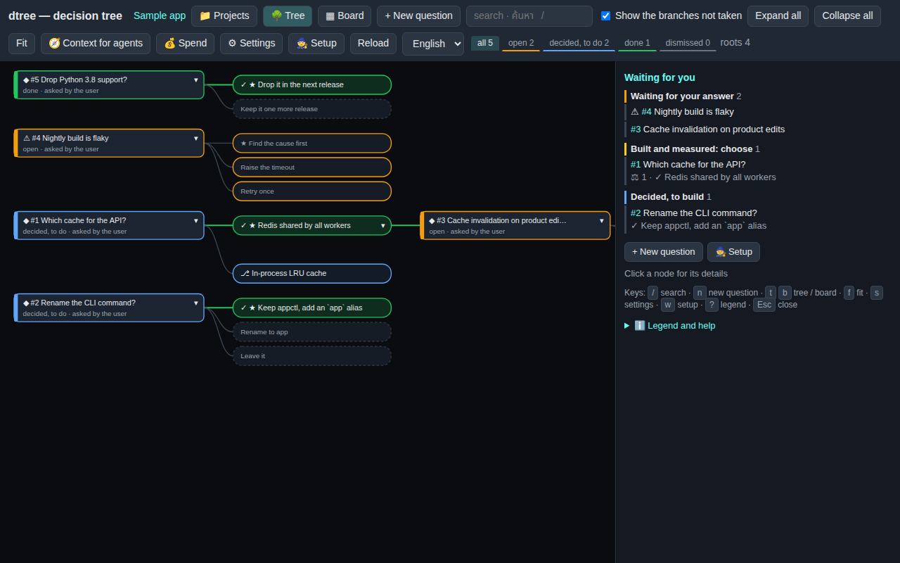

# OpenDtree — a decision tree for people and AI agents

OpenDtree is the project and the package (`pip install opendtree`); `dtree` is its command.
📖 **[The guide, in pictures](docs/guide.md)** — why dtree when you work with AI, the [architecture](docs/img/architecture.svg) and the [workflow](docs/img/workflow.svg), the page, one question step by step, agents, setup, projects, story mode, languages.

**Why, in one breath.** AI agents are fast and confident, but the decisions they ask for vanish with the chat. dtree keeps them: a
question is answered once and every agent reads it before working; the option not taken is built on its own branch and measured with
the same tests before anyone chooses; dtree verifies the tests itself; agents work in a sandbox with caps and never merge or push; the
history, the cost and the reasons stay. Agents ask, propose and build — a person decides.

[](docs/guide.md)

## Architecture


One process on the Python standard library. The page, the JSON API, the CLI and the MCP server share one **project** (`.dtree/config.json`)
and one **store** (a SQLite file); each feature module adds its routes and commands. Outside dtree: the git repository (branches and
worktrees, nothing pushed), the sandbox (bubblewrap and the egress proxy), the model APIs, and the files under `~/.config/dtree`.

## Workflow


The **person** asks, answers, tries another option, chooses and merges; **dtree** stores, branches, runs the job under its caps, verifies
and compares; the **agent** reads the decisions in force and builds one option on its own branch; **git** holds the branches and the
merge. A story (mode `story`) uses only the first two steps. The [guide](docs/guide.md) walks through each step with screenshots.

dtree keeps the questions waiting for a person, their options and the answer taken, and draws them as a tree. An option not taken
can be tried later on its own git branch and handed to an AI agent: Claude Code, Codex, Muse, Grok or a local model. The agent builds
it in a separate worktree, never merges, and measures it for the person to choose. dtree has no dependencies beyond Python 3.9+ and git.


## Start

```bash
pip install -e /path/to/opendtree         # this repository; gives the `dtree` command
cd your-repo && dtree init                # .dtree/config.json (rules, tests, agents) + .dtree/.gitignore
dtree serve                               # http://127.0.0.1:5077/ — the tree, answering, trials, AI jobs
```

## The page

- **Waiting for you.** With nothing selected, the side panel lists what needs a person: questions waiting for an answer,
  trials built and measured to choose from, AIs building, decisions waiting to be built — each a click away. The legend and the long
  help sit under ℹ️ at the bottom, closed until opened.
- **Setup.** A first-run wizard on the settings API, step by step: tick the AIs from dtree's presets, paste each chat
  AI's key (on the server's own machine; from elsewhere it shows the `dtree key` command instead), test each one, choose the default,
  then ask the first question. A banner offers it when no AI can run here; `/?setup=1` opens it at once.
- **Filters.** The counts under the toolbar are chips: press one to see only the open, decided, done or dismissed questions
  (the tree fades the rest, the board hides them); press it again for all.
- **Keys.** `/` search · `n` new question · `t` / `b` tree / board · `f` fit · `s` settings · `w` setup · `p` projects · `?` legend ·
  `r` reload · `Esc` close. Never while typing in a box. On a narrow screen the toolbar shows icons only.

## Languages

English first, more languages beside it (2026-11-04).

- **The page.** English and Thai are built in; the language menu in the toolbar (or `/?lang=ja`) switches. Any other language is a
  translation file — `~/.config/dtree/lang/<code>.json` (or the package's `static/lang/`): `{"_name": "日本語", "Settings": "設定", …}`,
  every key an English string the page shows; what the file lacks stays English. `dtree lang-template --out ja.json` writes the file to
  fill in (`--code ja` keeps what is there), `dtree lang-check ja` says how complete it is, `dtree languages` lists what the server finds.
- **The questions.** A title, a question, a context and each option carry their words per language: English and Thai have their own
  fields (`title_en`, `title_th`, …), every other language goes in `texts` — on the API as `{"title": {"en": …, "th": …, "ja": …}}`
  or `{"texts": {"ja": {"title": …, "question": …}}}`, an option as `{"key": "left", "en": "Left", "texts": {"ja": "左"}}`. The page
  shows the language chosen and falls back to English, then Thai; the forms take English and one more language (Thai, or the one
  shown); search finds words in any language. A question needs its title and question in English or Thai at least.
- **The book.** `dtree book --lang ja` (or `GET /api/story/export?lang=ja`) writes English with that language beside it; `--lang en`
  English alone; Thai is the default second language.

## Story mode (a gamebook)

A project made with `"mode": "story"` (`dtree new NAME --mode story`, or 📁 → new) is a branching story: every question is a **scene**,
its options are the **reader's choices**, and the scene written after a choice hangs on that choice (the store's `follows` +
`follows_option`); a scene with no choices is an ending. Nothing is answered and nothing is tried on a branch — every branch is real.

- **Write.** "+ New scene" adds an opening scene; on a scene, each choice without a scene has "+ Write the scene", which opens the form
  linked to that choice. "✎ Edit" rewrites a scene's title, text and choices (a choice keeps its key, so what follows it stays linked).
- **Read.** "▶ Read from here" (or "▶ Read from the start" in the side panel) reads it as a reader does: one scene, the choices as buttons,
  unwritten ones greyed with "✎ write it", endings marked, the way taken so far on top.
- **The book.** `dtree book [--out FILE]` or "📥 Export the book (.md)" writes the whole story as Markdown: scenes numbered by id,
  each choice with "→ go to N" (`GET /api/story/export`); `GET /api/story` gives the scenes as JSON for anything else.

## Projects: new, open, edit, import, export, save as

One server shows one project at a time, and 📁 (or `p`) switches it in place: the projects this machine knows (`~/.config/dtree/projects.json`),
each opened with a click; **＋ New** makes one under `~/dtree-projects` (`$DTREE_PROJECTS_DIR`: `dtree init` + `git init`, a story or a
decisions project); **✎** renames the current one or changes its mode; **📤 Export** downloads the whole project as one JSON file — its own
config keys that travel (name, mode, base, rules, docs, test_command) and every question with its history and trials, never a key, an
agent's settings, a job or a path of this machine; **📥 Import** makes a new project from such a file (ids kept; never into an existing one);
**💾 Save as** copies the current project under a new name. Making, opening, editing, importing and saving as are done from the
server's own machine only; the page opened from another machine can still export.

```bash
dtree projects                                   # the registry, the current one first
dtree new "The two doors" --mode story              # a new project (--dir elsewhere than ~/dtree-projects)
dtree --project DIR export --out tale.json       # the whole project as one file
dtree import tale.json --name "Tale 2"           # a new project from it
dtree --project DIR save-as "Tale 3"             # a copy
dtree --project DIR book --out tale.md           # a story as a Markdown book
```

## The way of one question

1. **Ask.** Questions are raised with `dtree add q.json`, the MCP tool `dtree_ask`, or "+ New question" on the page. A question
   whose text names an earlier one as "#N" grows from it in the tree.
2. **Answer.** The person answers on the page or with `dtree answer ID OPTION`.
3. **Build.** Run `dtree start ID`, which switches to `dec/ID-OPTION`. Commit there and run the tests. Then run `dtree merge ID`
   (`--no-ff`; the branch is kept and its commits are recorded; no checkout is switched — see "Merging" below), and close with
   `dtree done ID --tests … --impact …`.
4. **Try another option.** Click "⎇ Try this option" or run `dtree try ID OPTION`. This makes the branch `alt/ID-OPTION`.
   The answer stays as it is until a measured trial is adopted.
5. **Send to an agent.** Click "🤖 Send to the AI" and choose the agent, or run `dtree ai TRIAL --agent NAME`.
   - The agent works in a worktree outside the repository and ends at the measurement.
   - dtree then checks the work itself (below) and shows it beside the agent's own report.
   - The person then chooses: adopt it, keep both as a switch, or drop it. An adopted trial is merged with
     `dtree merge ID --trial TID [--close]`; `dtree update TID` first brings it up to date with the base.
   - Follow the job with `dtree jobs`, `dtree log JOB` and `dtree stop JOB`.

## Several agents, the same work, compared

Click "⚖ Several AIs, compare" on an option, or run `dtree race ID OPTION --agents claude,codex,muse`. This works on a question that
is still open, too: the person can choose from what was built and measured, not only from the words.

- **Branches.** Each agent builds the same option on its own branch, `alt/ID-OPTION--AGENT`, in its own worktree, and they run at
  the same time. `max_parallel_jobs` (3 by default) limits how many run at once.
- **Comparing.** The "⚖ Compare" table, or `dtree compare ID`, shows for each agent: status, tests, effect, commits, files and lines
  changed, cost or tokens, and time — of all the trial's jobs together (its build, follow-ups and updates). `dtree compare` prints the
  agent's own claim, then dtree's own check beside it (tests on the tip and on the base, the change, each measure) and whether it merges.
- **Choosing.** Adopt one with `dtree end TRIAL adopted --drop-others` (the page asks too). On an open question, that answers it; the
  others are dropped and their branches stay in git. A job still running on a dropped trial is stopped (it ends `stopped`, never
  measured). Then run `dtree merge ID --trial TRIAL` (`--close` marks the question done).
- **Branches of their own.** Two options whose keys git would turn into one name (two keys in a non-Latin script both become `option`; `a/b` and
  `a-b`) get a short hash of the key after it, so no two options ever share a branch.

## dtree checks the work itself

An agent's "tests 3 passed" is its own claim. After a job that ends with commits (when `verify.tests` or `verify.measures` is set),
with `dtree verify TRIAL`, or with "🔎 Verify" in the compare table, dtree runs the project's tests and measures itself, in the sandbox
(no network; nothing writable but a fresh worktree), on the trial's tip and on the commit it left the base from. The compare table then
shows both beside the agent's words: the counts, the change (+1 passed is a new test, +1 failed a test it broke), each measure with its
change in %, and whether the branch moved since. Results are kept by commit and command, so they are not run twice. With `{tests}` in
`verify.tests`, only the test files the changes select run. A project with only `test_command` is verified by hand (`dtree verify`),
not after every job. See [docs/verify.md](docs/verify.md).

- `dtree verify TRIAL [--force] [--no-baseline]` (exit 0 passed · 1 not passed or refused · 3 nothing was run) ·
  `dtree verify TRIAL --background` (exit 0 the runner started, 1 refused; the result comes later: `dtree checks --trial TRIAL`) ·
  `dtree checks [--trial TRIAL] [--sha SHA]`

## What an agent can reach, and what it may spend

- **Its own repository.** An agent's worktree belongs to the trial's shadow repository (`<worktrees>/.shadow/<branch>.git`, borrowing
  the project's objects). The project's `.git` — its other branches, HEAD, config and hooks — is read-only to it. When the job ends,
  dtree brings the branch back itself: fast-forward only, every object checked.
- **Nothing it plants runs on the host.** A job can write its shadow (Codex's own sandbox lets it write the whole of it). dtree keeps
  what it made the shadow with beside it (`<branch>.pin.json`, where no job writes) and, before each of its own git commands there —
  after the job, every readiness poll, an update, an abort — puts back the config, `HEAD`, alternates, the worktree's `.git` file and
  its `gitdir` / `commondir`, and removes hooks, `info/attributes` and `config.worktree`: a filter, a merge driver, `gpg.program`, a
  hook or a `.git` pointing elsewhere never runs. What Codex's commands left running is ended with the job.
- **A worktree deleted by hand loses nothing.** When the shadow holds commits that never came back (a runner that ended first),
  merge-check says `not_brought_back` even without the worktree, and the next job or `dtree update` brings them back first.
- **Its own little world.** Commands run in bubblewrap: an empty `$HOME`, the project's tool installations read-only, secrets masked,
  no unix sockets of the host. Claude Code runs inside it too, and reaches only its own API through dtree's egress proxy (no localhost
  services, no other hosts unless `network_allow` says so); the chat loop's commands (Muse, Grok, local, the Orin) have no network at
  all, and dtree calls the model's API from outside. Codex uses its own sandbox. See [docs/sandbox-and-budget.md](docs/sandbox-and-budget.md).
- **What it may spend.** A cap per job (dollars for Claude Code, tokens for the others), a monthly budget for all agents, and caps per
  agent per month (`month_usd` / `month_tokens`) or in all, whatever the month (`total_usd` / `total_tokens`). A job is not started
  when a budget is used up, and a running job is held to what is left. For a credit — Muse's $150 for a hackathon, say — cap the agent
  in all: `"agents": {"muse": {"total_usd": 150, "price_in_per_mtok": …, "price_out_per_mtok": …}}` with the provider's prices (Muse's
  API reports tokens only, so dollars need prices), or `"total_tokens": …` without them. `dtree spend [--month YYYY-MM]` shows the
  spend per agent and what is left of each cap ("at most" when some jobs' cost is not known).
- **Per question.** 🪙 on each node of the tree (and on the board's cards) is the tokens its AI jobs used; hovering adds the dollars,
  time and the total with the questions that grew from it (Σ on a folded node); the side panel splits it by AI and by trial.
  `dtree usage` lists every question's, `dtree usage ID` one's. Only the jobs dtree runs are counted — work done outside dtree (by
  hand, or an AI in its own session) is not in the store.

## Merging

- **Before.** `dtree merge-check TRIAL` (and the compare table) shows whether a trial merges cleanly into the base now — computed
  with `git merge-tree`, nothing touched — which files would conflict, how far the base moved since, and where the base is checked out.
  It exits 1 when the trial cannot be merged now, so `dtree merge-check T && dtree merge ID --trial T` is safe in a script.
- **Merge.** `dtree merge ID --trial TRIAL [--close]` merges without switching anyone's checkout: by plumbing when the base is checked
  out nowhere, else with `git merge` in the clean checkout where it is. Files git does not track that the merge would overwrite stop it.
- **Update.** `dtree update TRIAL [--agent NAME]` merges the base into the trial's branch. When that conflicts, an agent resolves it
  (only `git add` and `git commit`), dtree checks no conflict is left, and verifies the trial again. `--abort` undoes it.
  Until dtree accepts an update, the trial is not merged (merge-check says `markers` or `update_unchecked`); `dtree update TRIAL`
  checks again an update whose job ended without the check.
  See [docs/merge.md](docs/merge.md).

## Board, diff, follow-up (from Vibe Kanban)

- **Board.** The "▦ Board" view puts every question in a column: open → AI building → to choose → decided, to build → done.
  The tree view stays one click away. `?view=board` opens the board directly.
- **diff.** "± diff" on a trial shows everything its branch changes, file by file. `dtree diff TRIAL` does the same.
- **Follow-up.** "↻ Follow up" on a trial, or `dtree followup TRIAL --feedback "…" [--agent NAME]`, sends the person's feedback
  and lets the agent go on with the work on the same branch. The agent's prompt shows the commits already there and the last result.
  A follow-up refused before it starts, or whose job never reaches its agent (no runner, no agent, no worktree), leaves the trial
  measured with its result, unless a newer measurement came meanwhile.

## ADR (Architecture Decision Records)

- **ADR files.** `dtree adr` writes every question as `docs/decisions/NNNN-slug.md` in the MADR shape, plus an index:
  status, context, considered options with their good and bad points, the outcome and the person's note, what was done (tests,
  effect, commits), options tried later, and links. They are made from the store, so they can be committed with the code.
  "📄 ADR" on the page previews one.
- **Pros and cons.** An option may carry `"pros": [...]` and `"cons": [...]`.
- **Superseded.** `dtree supersede OLD --by NEW` marks a decision as replaced by a later one; the tree dims it.
- **Context for agents.** `dtree context` (MCP `dtree_context`, "🧭" on the page) lists the decisions in force, one
  line each, to put in AGENTS.md or CLAUDE.md or to read before work.

## Agents

| name | kind | how it runs | what it needs |
|---|---|---|---|
| `claude` | claude | `claude -p --output-format stream-json --permission-mode auto --json-schema …`, in bubblewrap behind dtree's egress proxy | Claude Code installed and logged in; bwrap able to make namespaces here |
| `codex` | codex | `codex exec --json -s workspace-write --output-schema …` (its own sandbox) | Codex installed, `codex login` |
| `muse` | chat | dtree's tool loop on the Meta Model API (`https://api.meta.ai/v1`, `muse-spark-1.3`) | key in `$MODEL_API_KEY` or `key_file` |
| `grok` | chat | dtree's tool loop on the xAI API (`https://api.x.ai/v1`) | key in `$XAI_API_KEY`; set `model` to one your account lists |
| `gemini` | chat | dtree's tool loop on Google's OpenAI-compatible Gemini API (`https://generativelanguage.googleapis.com/v1beta/openai`, `gemini-3.5-flash`) | key in `$GEMINI_API_KEY` or `key_file`; `model` one your key lists (`gemini-2.5-flash` is gone for new keys) |
| `local` | chat | dtree's tool loop on Ollama (`http://127.0.0.1:11434/v1`) | `ollama serve` and a model that supports tool calls |

- **The chat loop.** It gives the model six tools: `list_files`, `read_file`, `write_file`, `edit_file`, `run` and `finish`.
  - The file tools work only inside the worktree.
  - `run` executes commands in **bubblewrap**: the filesystem is read-only except the worktree, the git directory and a private
    `/tmp`, and there is **no network**.
  - Commands that change branches, merge, push, or use sudo or ssh are refused before they run.
- **Adding an agent.** Any OpenAI-compatible server can be added under `"agents"` in `.dtree/config.json`:

  ```json
  "agents": {"glimmer": {"kind": "chat", "label": "Muse Glimmer (llama.cpp)", "base_url": "http://host:8095/v1", "model": "muse-glimmer-30b-q5",
                         "request_timeout_s": 1800}}
  ```

  `request_timeout_s` (default 600) is how long one request may take: a slow local model needs more (the Orin's shared llama.cpp
  server took 281 s for one 1024-token answer).

- **Measured on 2026-11-01.** Muse and Muse Glimmer on the Orin each built the same small option in a race (add a function and its
  test). Both builds were correct and their tests passed:

  | agent | steps | tokens | time | where |
  |---|---|---|---|---|
  | Muse Spark (Meta Model API) | 8 | 21k | 17 s | cloud |
  | Muse Glimmer 30B Q5 | 7 | 15k | 12.6 min | the Orin's llama.cpp server: ~5 tokens/s, 8192-token context (`context_chars` 16000), shared with other work |

- **Keys.** A key is read when it is needed and is sent only in the `Authorization` header. It is never logged or stored by dtree.
- **Checking agents.** `dtree agents` lists every agent and whether it can run here; if it cannot, it says why.

## MCP

With `dtree mcp`, any agent that speaks MCP can use the store. It can raise questions, read the answers and record the finished work.

```bash
claude mcp add dtree -- dtree --project /path/to/repo mcp
# Codex: ~/.codex/config.toml →  [mcp_servers.dtree]  command = "dtree"  args = ["--project", "/path/to/repo", "mcp"]
```

The tools are `dtree_ask`, `dtree_context`, `dtree_list`, `dtree_get`, `dtree_done`, `dtree_comment`, `dtree_trials`, `dtree_measured` and `dtree_code`.
Agents never answer questions; the person does.

## Schema

[docs/schema.md](docs/schema.md) covers the five tables (`decisions`, `events`, `trials`, `jobs`, `checks`) with every column, the JSON
inside them (option, commit, every event's detail, the agent's result), the states of a question, a trial and a job, what is worked
out on each read, the limits, and compatibility with older stores. The JSON Schemas are in [src/dtree/schema/](src/dtree/schema/):
`question.schema.json` (a question to add), `result.schema.json` (every agent's last word) and `config.schema.json`
(`.dtree/config.json`). `tests/test_schema.py` keeps them in step with the code.

## Settings

"⚙ Settings" on the page, or the CLI, sets what is in `.dtree/config.json` without editing it by hand: the jobs, the budget, the chat
loop, dtree's checks and the allowed host names, and per agent its model, address, rate limits (`requests_per_minute`,
`requests_per_day`), retries, caps and prices; it adds an agent (from a preset or any OpenAI-compatible API) or removes one, keeps a
chat agent's key, and tests an agent (`GET /models` with its key). See [docs/settings.md](docs/settings.md).

- **Checked first.** Every value is checked by its kind and range, then the whole new config (the default agent must exist; no agent may
  come to have settings that refuse every job); nothing is written when anything is refused, and the answer names the setting.
- **Written carefully.** Atomically, the file's mode, its notes (`_…`) and every key not touched kept, in `dtree init`'s format, under a
  lock the server and the CLI share. The running server uses the new settings from the next request and every new job (a running job
  keeps its own); `server.host` / `server.port` need a restart. Each change is a line in `<logs>/settings.log`, never a key.
- **Keys.** Set from this machine only: the LAN connection is plain HTTP. A key goes to the agent's `key_file`, else to
  `~/.config/dtree/keys/<project>-<agent>.key` (0600, its directory 0700); removing it deletes only dtree's own file, never another
  tool's. No answer, log or page ever has the key, nor any part of it. From another machine, an agent's `base_url`, `key_env` and what
  weakens a sandbox (`sandbox`, `network`, `network_allow`, `credentials`, `chat.sandbox`) cannot be changed either.

```bash
dtree settings [--json]                       # every setting: in effect, in the file, the default
dtree set agents.gemini.requests_per_minute 5 # VALUE as JSON when it parses, else text
dtree unset chat.retries                      # back to the default
dtree key gemini [--remove]                   # asked without echo (or one line of stdin); never printed
dtree test-agent gemini                       # exit 1 when it cannot run or its API does not answer
```

## `.dtree/config.json`

| key | what it is |
|---|---|
| `name` | the project's name |
| `base` | the base branch, `main` by default |
| `db` | the store, `.dtree/decisions.sqlite` by default; `$DTREE_DB` overrides it |
| `rules` | the project's rules, told to every agent |
| `test_command` | how the tests run |
| `docs` | where behaviour changes are documented |
| `merge_trailer` | a line added to merge commits |
| `worktrees` | where the agents' worktrees go, `../{name}-worktrees` by default |
| `timeout_s` | the time limit for one job |
| `max_parallel_jobs` | how many jobs run at once (3 by default) |
| `adr_dir` | where `dtree adr` writes the ADR files, `docs/decisions` by default |
| `chat` | the chat loop: `max_steps`, `max_tokens`, `command_timeout_s`, `request_timeout_s`, `retries` / `retry_max_wait_s` (an API that says it is busy — 429, 503 — is asked again), `sandbox` (`bwrap` or `none`), `deny`, `context_chars`, `result_chars` |
| `verify` | dtree's own checks: `tests` (`{tests}` → the selected files), `select`, `measures`, `baseline`, `workdir`, `timeout_s`, `auto` |
| `sandbox` | what sandboxed commands see: `root` (allowlist · host), `ro_binds`, `tmpfs`, `secrets`, `extra_ro`, `path_tools`, `env`, `gpu`, `nested` |
| `budget` | `month_usd`, `job_usd`, `job_tokens` — what agents may spend (`dtree spend`); per agent: `agents.<name>.month_usd`, `month_tokens`, and in all (a credit) `total_usd`, `total_tokens` |
| `merge` | `method`: auto (default) · plumbing · worktree — how a merge into the base runs |
| `default_agent` | the agent used when none is chosen |
| `agents` | overrides one agent, adds one, or removes one with `null` |
| `server` | `host` and `port`; `allowed_hosts`: names (besides IP addresses and `localhost`) the server may be opened by |

**Security.** The server binds 127.0.0.1 by default. If it is opened on the network, writes from other machines need the token in
`.dtree/write_token` (header `X-DTree-Token`; the page asks for it once). Binding to 127.0.0.1 alone does not keep out a web page of
another site open in your browser on the same machine — the browser connects from 127.0.0.1 — so the server also refuses:

- a write (POST) that is not `Content-Type: application/json`: a page of another origin cannot send that without a CORS preflight,
  which the server never answers (a `text/plain` POST needs none);
- a write whose `Origin` is not the server's own (`http://` + the `Host` it was opened by), or that says `Sec-Fetch-Site: cross-site`;
- any request whose `Host` is not an IP address, `localhost` or a name in `server.allowed_hosts`: a DNS name rebound to 127.0.0.1
  reads nothing and writes nothing.

The page itself sends JSON from its own origin, so it works as before, on the LAN too (`http://<your-server>:5077/`). A script that writes
to the API sends `Content-Type: application/json` and no `Origin`.

## Origin

dtree began inside ultimateTruth (2026-10-19 → 2026-11-01) and became its own tool on 2026-11-01. Its store schema is the same as
ultimateTruth's `data/decisions.sqlite`, so `dtree --project /path/to/ultimateTruth serve` works on that store.

```bash
PYTHONPATH=src python -m pytest tests -q      # the tests: stand-ins for the CLIs and a fake model API, no quota spent
```

## Licence

dtree is released under the **MIT License** ([LICENSE](LICENSE)): use it, change it, ship it and sell it, for any purpose, keeping
the copyright notice and the licence with it; it comes with no warranty.

**Status.** dtree is a tool its author built for one person's machine and LAN. The server binds 127.0.0.1 unless told otherwise, and
the settings back end (keys, rate limits, `⚙`) has not had a security review by anyone else yet. Read `Security` above before opening
it on a network.
