# dtree in pictures — a guide

dtree keeps the questions a project is waiting on — their options, the answer taken, and what happened after — and draws them as a
tree. An option not taken can be tried later on its own git branch, by you or by an AI agent, and measured beside the answer before
anyone chooses. The same page also writes a branching story (a gamebook). Everything here runs from one command, `dtree serve`, on
the Python standard library.

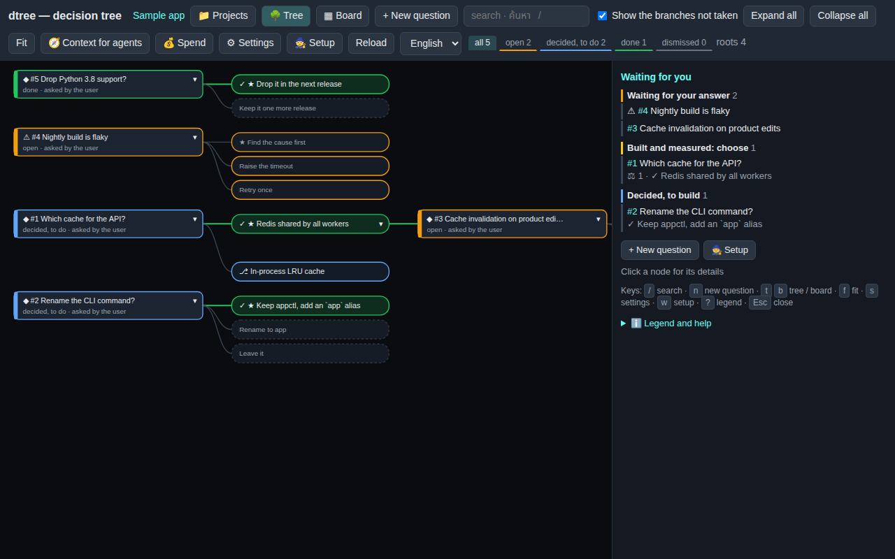

## Why dtree, when you work with AI

AI coding agents are fast and confident. What they lack is a place where the decisions live. A question comes up in a chat and you
answer it there, and it is gone with the session: the next agent asks again, or decides differently; the option that lost was argued,
never tried; "all tests pass" was the agent's word. dtree is that place.

- **Decide once, keep it.** Every question an agent (or you) raises goes to one store, with its options, in every language you use. You
  answer on the tree page; the answer is in force for every agent that reads `dtree context` (or the MCP tool) before it works.
- **Try the other way, measured.** An option not taken is built on its own branch — by you, by an agent, or by several agents at once —
  and measured with the same tests as the answer. The compare table shows tests, effect, diff, cost and time; you adopt it, keep both
  as a switch, or drop it. Decisions rest on measurements, not on who argued best.
- **Verified, not claimed.** dtree runs the project's tests itself, in a sandbox, on the agent's branch and on the commit it started
  from, and shows both beside what the agent said.
- **Agents in a box.** An agent works in a worktree of its own branch, in bubblewrap with no network but dtree's proxy; it cannot
  merge, push or touch your checkout. Each job has a cap, each agent a monthly cap, the project a budget; a job over a budget never
  starts, and says why.
- **Any agent, one workflow.** Claude Code, Codex, Muse, Grok, Gemini, a local model on Ollama or llama.cpp: presets, keys kept on your
  machine, one setting to switch, a race to compare them on the same option.
- **The reasons stay.** Every question keeps its history, trials, jobs, tokens and dollars; export the decisions as ADRs; the tree shows
  why the code is the way it is.
- **You decide.** Agents ask, propose and build. A person answers, chooses and merges.

For a developer or a small team using AI agents on a codebase that will outlive the chat. It is not a chatbot, an IDE or a PR bot, and
it never pushes.

## Architecture and workflow


One process on the Python standard library serves the page and the JSON API; the CLI and the MCP server use the same code without a
server. All of them share one **project** (`.dtree/config.json`) and one **store** (a SQLite file). Each feature module adds its routes
and commands: jobs (agents, the runner, races, the compare table), verify, merge, spend, settings, projects, story, languages. Outside
dtree sit the git repository (branches, worktrees, nothing pushed), the sandbox (bubblewrap and the egress proxy), the model APIs, and
the files under `~/.config/dtree` (keys, the project registry, translation files).


The lanes say who does what: the **person** asks, answers, tries, chooses and merges; **dtree** stores, branches, runs the job under
its caps, verifies and compares; the **agent** reads the decisions in force and builds one option on its own branch; **git** holds the
branches and the merge. A story uses only the first two steps.

Both drawings are also PNG, for slides or places that do not show SVG: [architecture.png](img/architecture.png) (2400 × 1520) and
[workflow.png](img/workflow.png) (2800 × 1200).

## 1. The page

- **Toolbar.** Tree / Board, `+ New question`, search, the status chips (`all` · `open` · `decided` · `done` · `dismissed` — press one to
  see only those), `Context for agents`, `Spend`, `Settings`, `Setup`, `Reload`, and the language menu.
- **The tree.** A question is a box; its options hang to its right; the option taken is green with ✓, the recommended one has ★; a later
  question that names an earlier one (“#3”) grows from the branch that one took. Drag to pan, wheel to zoom, `Fit` to see it all.
- **The side panel.** With nothing selected it shows **Waiting for you**: questions waiting for an answer, trials built and measured to
  choose from, AIs building, decisions waiting to be built — each a click away. Click a question for its details.
- **Keys.** `/` search · `n` new question · `t` / `b` tree / board · `f` fit · `s` settings · `w` setup · `p` projects · `?` legend · `r`
  reload · `Esc` close.

## 2. One question, step by step

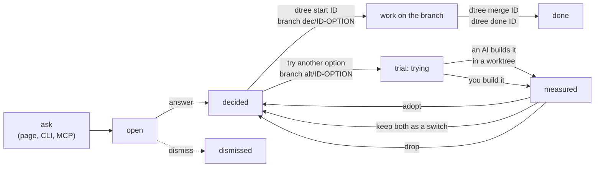

A question is **asked** (on the page, with `dtree add q.json`, or by an agent through MCP), **answered** by a person, **built** on its own
branch and **merged** without fast-forward, then marked **done** with the tests and the effect. Another option of a decided question
can be **tried** later on branch `alt/ID-OPTION`: dtree measures it beside the answer, and you **adopt** it, **keep both** as a switch,
or **drop** it. Nothing is merged by an agent; the person chooses.

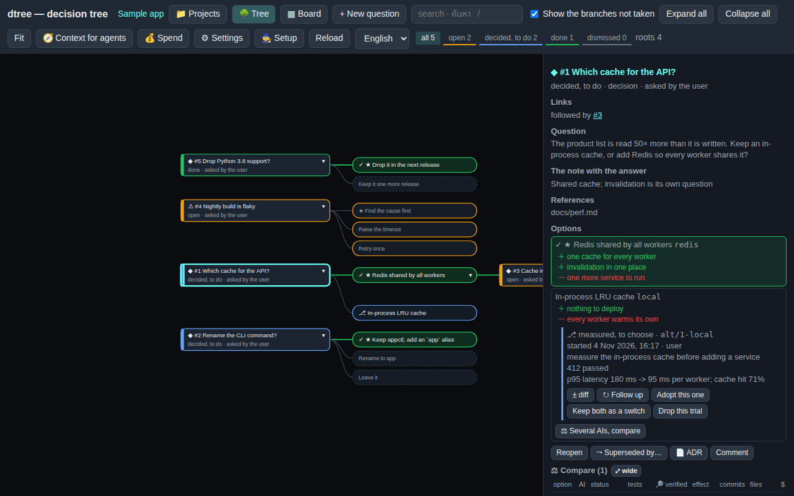

The side panel of a question shows its links to other questions, the question, the answer's note, the references, each option with its
pros and cons, every trial of an option (its branch, who started it, the measurement, `± diff`, `Follow up`, `Adopt`, `Keep both`,
`Drop`), `Several AIs, compare` to race agents on one option, and the **Compare** table (tests, effect, files, cost, time, dtree's own
verification, whether it merges now). Below it: `ADR` (the question as a decision record), `Superseded by…`, comments and the history.

## 3. The board

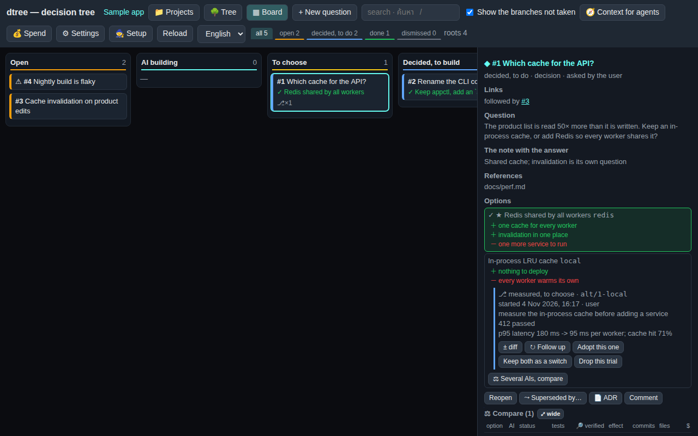

`Board` puts every question in a column: **Open** → **AI building** → **To choose** → **Decided, to build** → **Done** (and
**Dismissed / superseded** when “show the branches not taken” is on). Cards carry the answer, the trials, dtree's verification marks and
whether a trial is ready to merge.

## 4. Asking a question

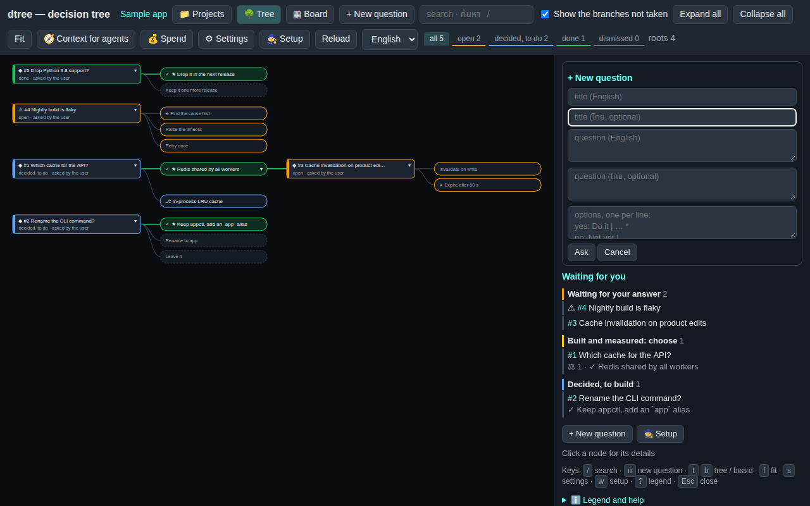

`+ New question` opens the form: a title and the question (English, and one more language), then the options one per line as
`key: English | second language`, with `*` on the recommended one. Options may carry pros and cons when asked through the API or MCP.

## 5. Agents, sandboxes and budgets

A trial is handed to an agent with `🤖 Send to the AI` (or `dtree ai TRIAL --agent NAME`): **Claude Code**, **Codex**, or a chat model
through any OpenAI-compatible API — **Muse Spark**, **Grok**, **Gemini**, a local model on Ollama, a llama.cpp server. The agent works in
a git worktree of the trial's branch, inside bubblewrap with no network but dtree's egress proxy, never merges or pushes, and ends at
the measurement. Each job has a cap (dollars or tokens), each agent a monthly cap, and the whole project a monthly budget; a job over a
budget is not started and says why. dtree then runs the project's tests and measures itself on the trial's tip and on the commit it left
the base from (`Verify`), and the compare table shows both beside what the agent claimed. See [sandbox-and-budget.md](sandbox-and-budget.md),
[verify.md](verify.md) and [merge.md](merge.md).

## 6. First run: the setup wizard

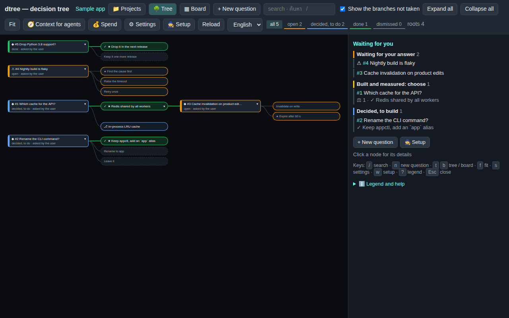

`Setup` (or `w`) walks through it: tick the AIs from dtree's presets, paste each chat AI's key (on the server's own machine only; from
another machine it shows the `dtree key` command instead), test each one, choose the default, then ask the first question. When no AI
can run yet, the side panel offers it.

## 7. Settings

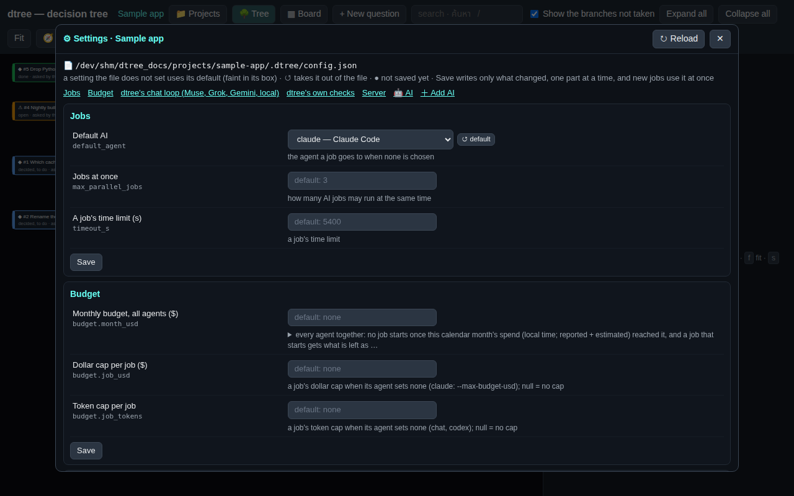

`Settings` (or `s`) edits `.dtree/config.json` from the page: jobs, the budget, the chat loop, verification, the server, and each agent
(model, address, rate limits, retries, caps, prices, its key). Every value is checked before anything is written; Save writes only
what changed, and new jobs use it at once. See [settings.md](settings.md).

## 8. Context for agents, ADR

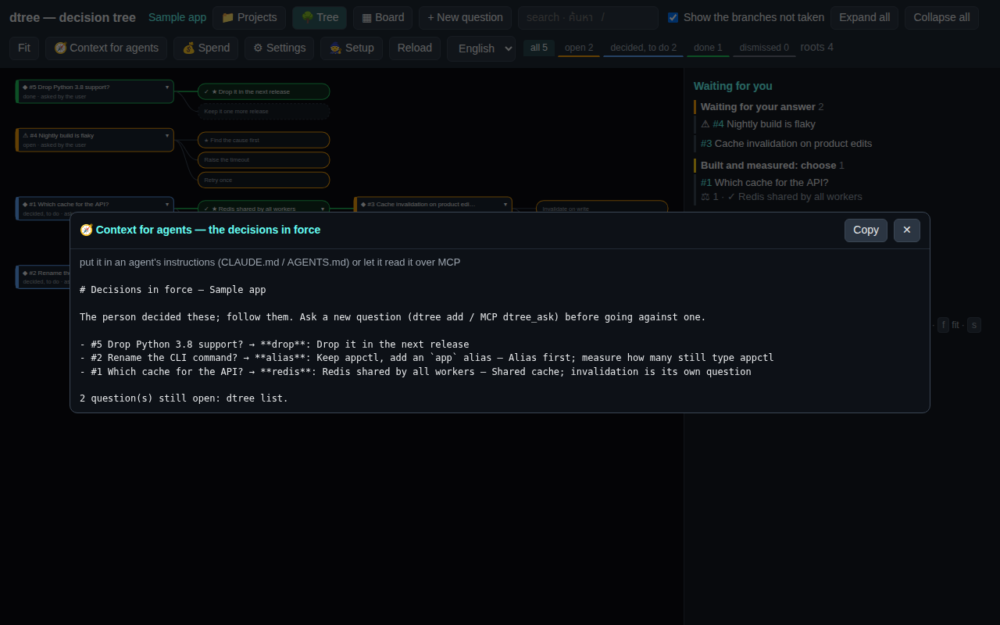

`Context for agents` lists the decisions in force, one line each, for an AI to read before working (`dtree context`, MCP `dtree_context`).
`dtree adr` writes every question as a decision record (MADR) under `docs/decisions/`, and the page previews one with `ADR`.

## 9. Projects

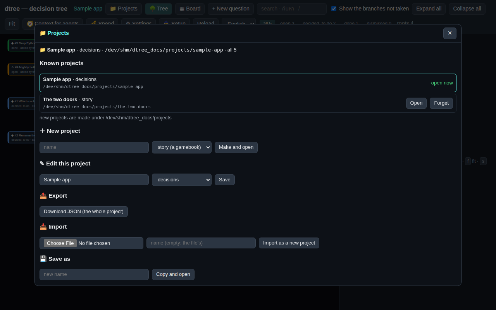

`Projects` (or `p`) switches the server to another project in place: the projects this machine knows, each opened with a click;
**New** makes one (`dtree init` + `git init`) as a decisions project or a story; **Edit** renames it or changes its mode; **Export**
downloads the whole project as one JSON file (its config keys that travel and every question with its history and trials — never a key,
an agent's settings or a path of this machine); **Import** makes a new project from such a file; **Save as** copies the current one.
Making, opening, editing, importing and saving as are done from the server's own machine only.

## 10. Story mode: a gamebook

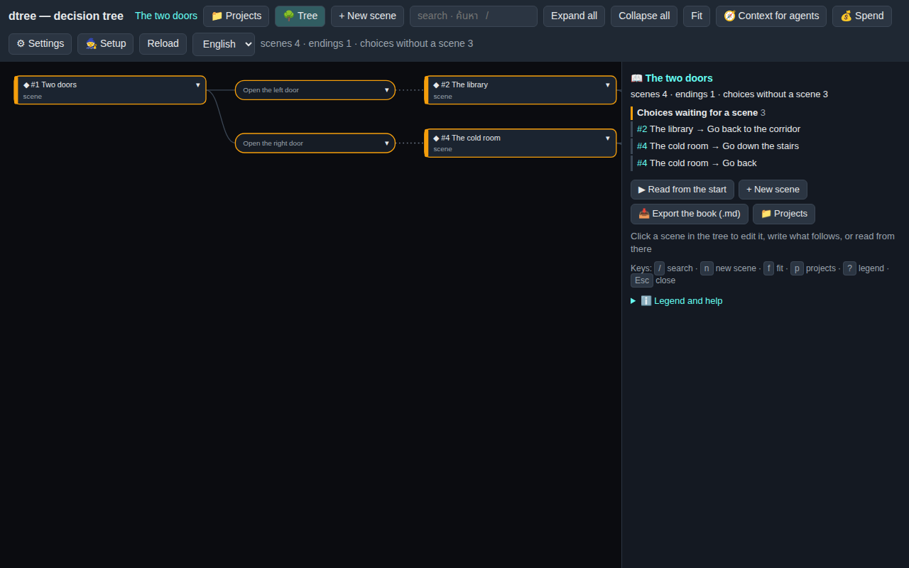

A project in story mode is a branching story: every question is a **scene**, its options are the **reader's choices**, and the scene
written after a choice hangs on that choice; a scene with no choices is an ending. Nothing is answered: every branch is real.

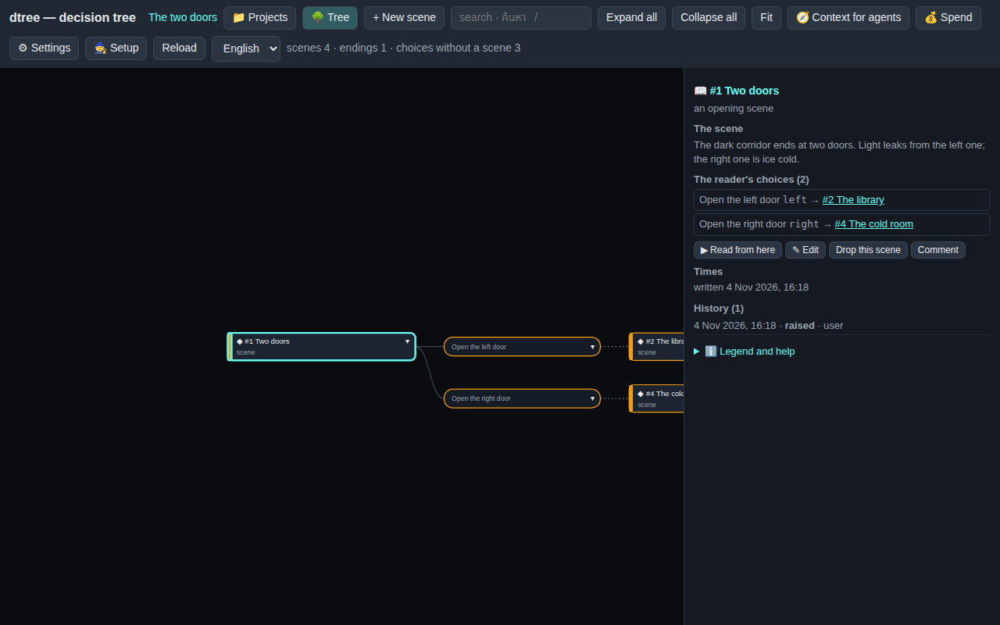

On a scene, each choice without a scene has `+ Write the scene`, which opens the form already linked to that choice; `✎ Edit`
rewrites the scene; `▶ Read from here` reads it as a reader does:

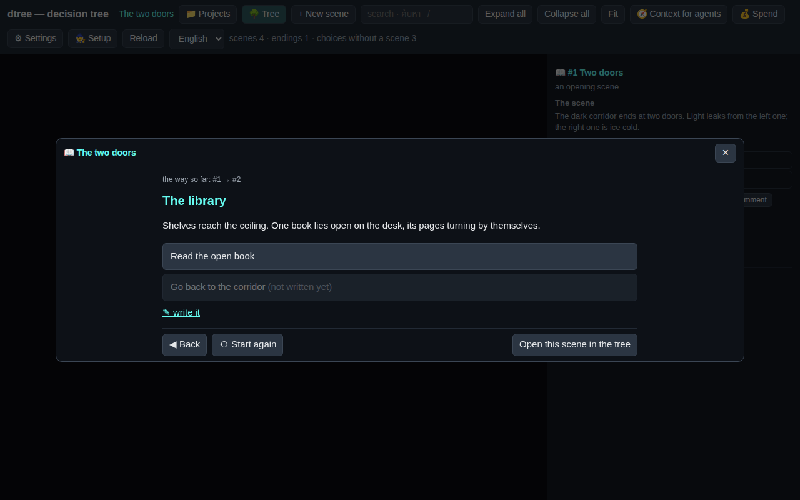

`dtree book` (or `Export the book (.md)`) writes the whole story as Markdown, scenes numbered by id, each choice with where it leads (`--lang th` or any language in the scenes' texts puts a second language beside the English):

```markdown
# The two doors

Start at scene 1

## 1. Two doors

The dark corridor ends at two doors. Light leaks from the left one; the right one is ice cold.

- Open the left door → go to 2
- Open the right door → go to 4
```

## 11. Languages

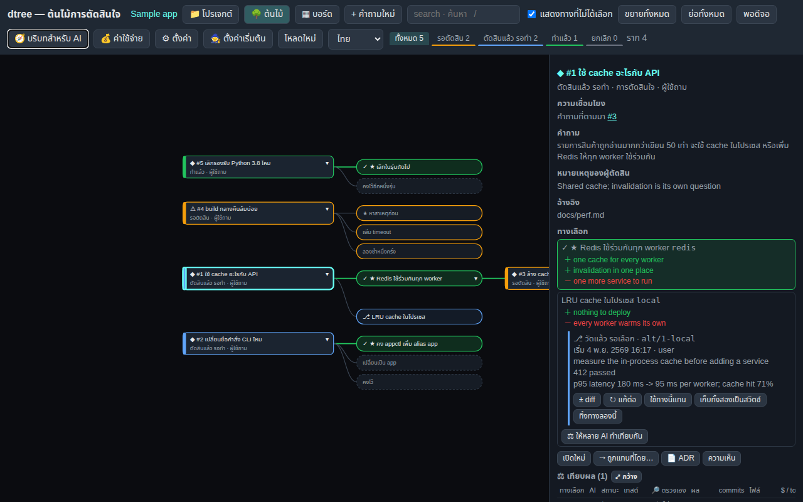

English first, more languages beside it. English and Thai are built in; the language menu switches the page's words and the questions'
words together. Any other language is a translation file (`~/.config/dtree/lang/<code>.json`, every key an English string the page
shows; `dtree lang-template` writes one to fill in), and a question's words in that language are stored with it (`texts`), so a story
can be read in Japanese with a Japanese page:

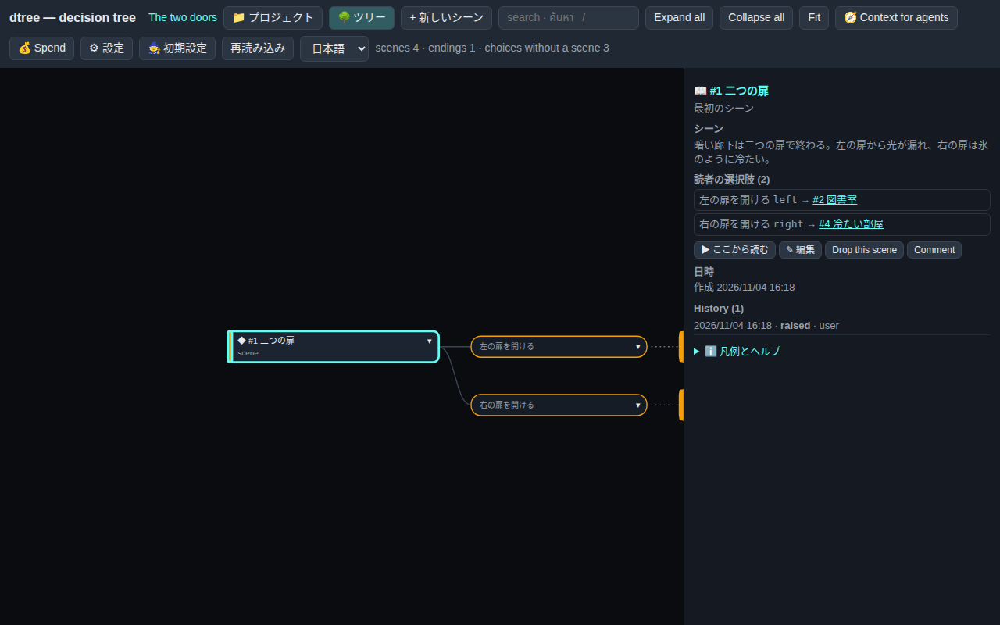

## 12. On a phone

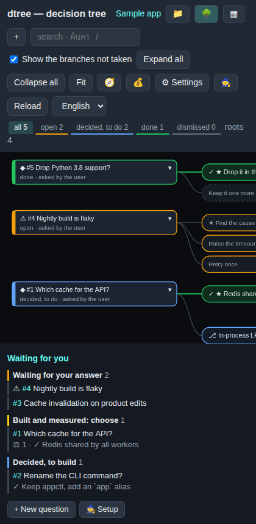

On a narrow screen the toolbar shows icons only and the side panel moves below the tree.

## 13. Install and run

```bash
pip install -e /path/to/opendtree          # this repository; gives the `dtree` command (Python 3.9+, git)
cd your-repo && dtree init                 # .dtree/config.json
dtree serve                                # http://127.0.0.1:5077/
dtree new "The two doors" --mode story     # or a story, under ~/dtree-projects
claude mcp add dtree -- dtree --project /path/to/repo mcp     # the store as MCP tools for an agent
```

The CLI covers everything the page does (`dtree --help`); the JSON API is what the page uses (`/api/decisions`, `/api/decisions/tree`,
`/api/story`, `/api/projects`, `/api/settings`, …). The schema of the store is in [schema.md](schema.md).
