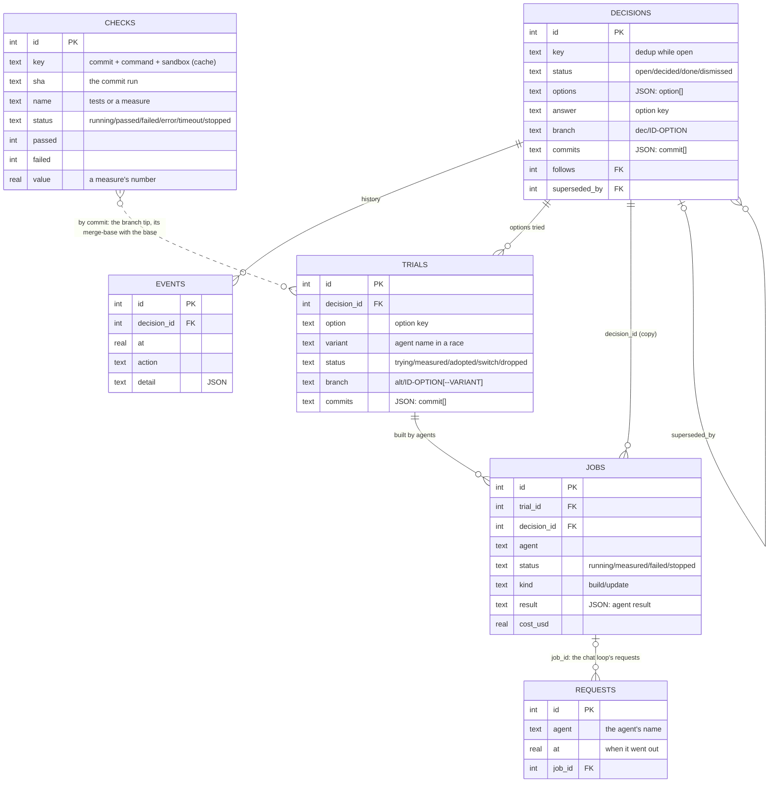
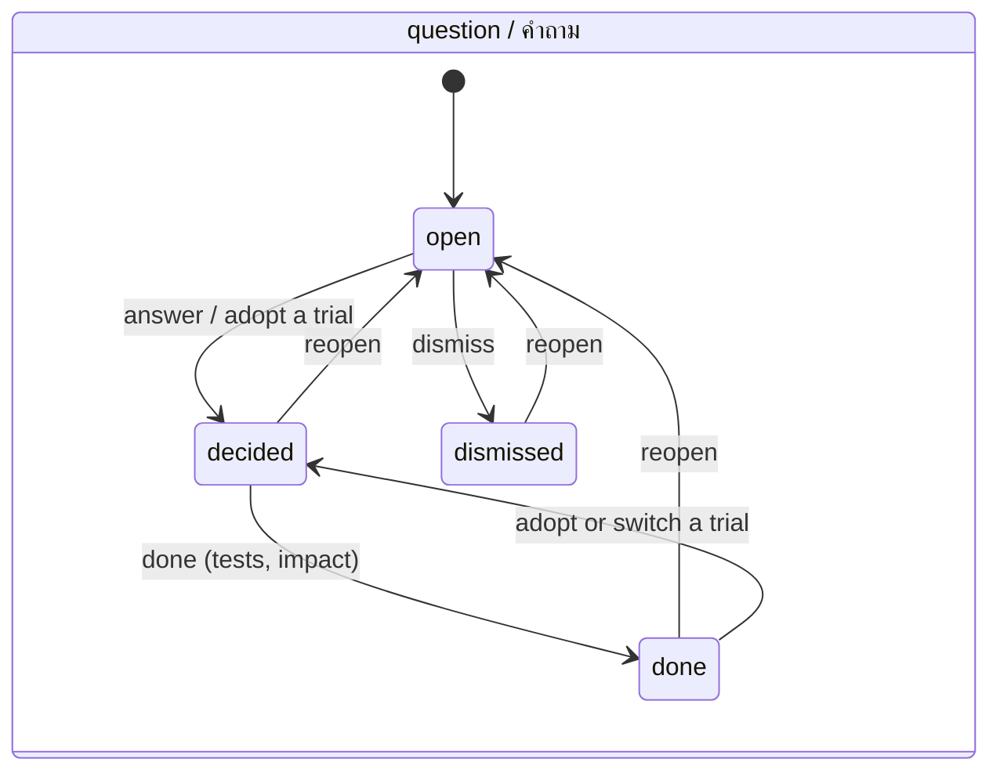
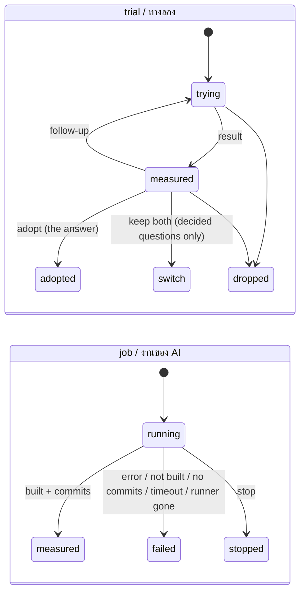

# dtree schema

dtree keeps everything in one SQLite file: five tables of questions, their history, trials, jobs and checks, and a sixth,
`requests`, that counts the requests sent to a model's API (an agent's rate limits). Each decision's code lives on git branches, and
each AI job's log is a file. The JSON Schemas for what goes in and what agents must answer are in [`src/dtree/schema/`](../src/dtree/schema/).
`tests/test_schema.py` (and `tests/test_rate.py` for `requests`) checks this page and those files against the code, so they cannot
drift apart.

## 1. Overview



**What lives where**

| what | where | in git? |
|---|---|---|
| the project's settings | `.dtree/config.json` ([config.schema.json](../src/dtree/schema/config.schema.json)) | yes |
| the store | `.dtree/decisions.sqlite` (WAL), or `db` in the config, or `$DTREE_DB` | no (`.dtree/.gitignore`) |
| the token for writes from other machines | `.dtree/write_token` (0600) | no |
| a job's log | `<logs>/job-N.log` (readable), `job-N.jsonl` (the agent's raw stream), `job-N.runner.log` | no |
| a check's output | `<logs>/check-N.log` (the whole output of the tests or the measure) | no |
| a decision's code | branch `dec/<id>-<option>`, merged into the base with `--no-ff` | yes (branches) |
| a trial's code | branch `alt/<id>-<option>` or `alt/<id>-<option>--<variant>` | yes (branches) |
| an agent's work in progress | `<worktrees>/alt-<id>-<option>[--<variant>]` (removed when clean), a worktree of the trial's shadow repository | a git worktree |
| a trial's shadow repository | `<worktrees>/.shadow/<branch>.git`: bare, the project's objects borrowed (alternates), only the trial's branch; the agent commits there and dtree brings the branch back (fast-forward only, objects checked); removed with its last worktree, never while it holds commits the project's branch lacks | no |
| what dtree made a shadow with (its pin) | `<worktrees>/.shadow/<branch>.pin.json`, beside the shadow where no job writes: `{version, branch, shadow: {HEAD, config, objects/info/alternates}, worktree: {path, admin, files: {.git, gitdir, commondir}}}` — put back before every git command of dtree's there ([merge.md](merge.md) §4); removed with the shadow | no |
| a verification's worktree | `<verify.workdir>` (default `<worktrees>/.verify`), one per commit run, removed after it | a detached git worktree |
| a verification running | `<logs>/verify-<trial>-<pid>.running`; a background one's output `<logs>/verify-<trial>.runner.log` | no |
| ADR files | `<adr_dir>/NNNN-<slug>.md` + `README.md` (`dtree adr`) | yes, when committed |

## 2. Tables

Times are Unix seconds (REAL). JSON columns are TEXT. "—" means NULL when not set.

### `decisions` — one row per question

| column | type | null / default | meaning |
|---|---|---|---|
| `id` | INTEGER PK | auto | the question's number, "#N" |
| `key` | TEXT | — | dedup: raising the same key while it is open counts it again (`occurrences`) instead of adding a question |
| `kind` | TEXT | not null | `decision` (a choice) · `problem` (something noticed) |
| `source` | TEXT | not null | who raised it: `system` · `claude` · `user` · `agent` |
| `status` | TEXT | `open` | `open` → `decided` → `done`, or `dismissed` (§4) |
| `created` | REAL | not null | asked |
| `updated` | REAL | not null | the last change the person would care about |
| `occurrences` | INTEGER | 1 | how many times it was raised while open |
| `title_th` · `title_en` | TEXT | not null | the title (≤ 200) |
| `question_th` · `question_en` | TEXT | not null | the question (≤ 4000) |
| `context_th` · `context_en` | TEXT | `''` | the background (≤ 4000) |
| `options` | TEXT JSON | `'[]'` | the options: an array of **option** (§3.1), ≤ 8 |
| `refs` | TEXT JSON | `'[]'` | references: documents, gaps, "#N" (a "#N" grows the tree from N) |
| `answer` | TEXT | — | the key of the option taken |
| `note` | TEXT | — | the person's note with the answer |
| `decided_at` · `decided_by` | REAL · TEXT | — | answered: when, by whom |
| `done_at` · `done_by` | REAL · TEXT | — | the decided work finished |
| `result_tests` · `result_impact` | TEXT | — | when done: the tests run with their counts, and what changed |
| `follows` | INTEGER → decisions.id | — | the earlier question it follows when its text names none |
| `follows_how` | TEXT | — | `topic` (the same subject) · `sequence` (only asked next) |
| `follows_why` | TEXT | — | why it follows (required with `follows`) |
| `follows_option` | TEXT | — | the key of the earlier question's option it hangs on (a story's scene after one choice, 2026-11-04); without it the tree uses the answer in force when it was raised |
| `texts` | TEXT (JSON) | `{}` | words in languages beyond en and th: `{"ja": {"title": …, "question": …, "context": …}}` (2026-11-04, English first; the page shows the language chosen and falls back to English) |
| `branch` | TEXT | — | its code branch `dec/<id>-<option>` |
| `commits` | TEXT JSON | — | its commits: an array of **commit** (§3.2) |
| `superseded_by` | INTEGER → decisions.id | — | ADR: a later question replaced this decision |

Indexes: `decisions_status (status, updated)`, `decisions_key (key, status)`.

### `events` — everything that happened to a question

| column | type | null / default | meaning |
|---|---|---|---|
| `id` | INTEGER PK | auto | |
| `decision_id` | INTEGER → decisions.id | not null | |
| `at` | REAL | not null | when |
| `action` | TEXT | not null | what happened (§3.3) |
| `by` | TEXT | `''` | who: `user`, `cli`, an agent's name, `system` |
| `detail` | TEXT JSON | `'{}'` | the action's fields (§3.3) |

Index: `events_decision (decision_id, at)`. Events are only added, never changed: they are the history of the tree.

### `trials` — an option built on its own branch

| column | type | null / default | meaning |
|---|---|---|---|
| `id` | INTEGER PK | auto | the trial's number |
| `decision_id` | INTEGER → decisions.id | not null | |
| `option` | TEXT | not null | the option key being built |
| `variant` | TEXT | — | in a race, the agent's name; several trials of one option can be open, one per variant |
| `status` | TEXT | `trying` | `trying` → `measured` → `adopted` · `switch` · `dropped` (§4) |
| `branch` | TEXT | `''` | `alt/<id>-<option>` or `alt/<id>-<option>--<variant>`, the key made fit for git (other characters become `-`; none left: `option`). Never another option's: when a trial of another option of the question has that name (two keys in a non-Latin script both become `option`), a short hash of the key follows it (`alt/<id>-option-1f3a9c`). The same option tried again keeps its branch |
| `created` · `updated` | REAL | not null | |
| `by` | TEXT | `''` | who opened it |
| `note` | TEXT | `''` | the person's note for it |
| `result_tests` · `result_impact` | TEXT | — | the measurement (same tests as the answer); cleared by a follow-up |
| `ended_at` · `ended_by` · `ended_note` | REAL · TEXT · TEXT | — | the person's choice |
| `commits` | TEXT JSON | — | its commits: an array of **commit** (§3.2) |

Index: `trials_decision (decision_id, id)`.

### `jobs` — a trial handed to an agent

| column | type | null / default | meaning |
|---|---|---|---|
| `id` | INTEGER PK | auto | the job's number |
| `trial_id` | INTEGER → trials.id | not null | |
| `decision_id` | INTEGER → decisions.id | not null | the trial's question (copied, for listing) |
| `agent` | TEXT | — | the agent's name in the config (`claude`, `codex`, `muse`, `grok`, `gemini`, `local`, `orin`, …) |
| `status` | TEXT | `running` | `running` → `measured` · `failed` · `stopped` (§4) |
| `created` · `updated` · `ended_at` | REAL | | |
| `by` | TEXT | `''` | who sent it |
| `note` | TEXT | `''` | the note or follow-up feedback to the agent |
| `runner_pid` · `agent_pid` | INTEGER | — | the runner process and the agent's process group (for stop) |
| `stop_requested` | INTEGER | 0 | the person asked to stop |
| `worktree` · `log` | TEXT | — | where it works and logs |
| `reason` | TEXT | — | why it ended as it did |
| `result` | TEXT JSON | — | the agent's result (§3.4) |
| `cost_usd` | REAL | — | what the job cost: reported by the agent (Claude Code) or estimated from its tokens and the agent's prices |
| `kind` | TEXT | `build` | `build` (build the option; a follow-up too) · `update` (bring the branch up to date with the base: resolve a merge's conflicts) |

Index: `jobs_trial (trial_id, id)`. At most `max_parallel_jobs` run at once, and one per trial.

### `checks` — a command dtree ran itself on one commit

dtree's own verification (`verify.py`): the project's tests or a measure, run on one commit in a sandbox. A trial is compared through
its branch tip and the commit it left the base from (the baseline). The result of a command on a commit does not change, so a row
with the same `key` that ended `passed` or `failed` is reused: a race of agents from one base runs each baseline check once — its
measures, and its tests when the trials give the base the same selection (with `{tests}`, once per distinct selection; see verify.md).

| column | type | null / default | meaning |
|---|---|---|---|
| `id` | INTEGER PK | auto | |
| `key` | TEXT | not null | the cache key: a hash of the commit, the command and the sandbox settings |
| `sha` | TEXT | not null | the commit that was run |
| `name` | TEXT | not null | `tests`, or the measure's name |
| `kind` | TEXT | `tests` | `tests` (counted) · `measure` (one number) |
| `command` | TEXT | not null | the exact command, after the test selection |
| `status` | TEXT | `running` | `running` → `passed` (exit 0, nothing failed; a measure read its number) · `failed` (tests failed) · `error` (could not run or read) · `timeout` · `stopped` |
| `created` · `updated` · `ended_at` | REAL | | |
| `by` | TEXT | `''` | who asked first (`job 12`, `cli`, `user`) |
| `runner_pid` | INTEGER | — | the process running it (a check whose process is gone is taken over) |
| `exit_code` | INTEGER | — | the command's exit code |
| `framework` | TEXT | — | the test runner the summary was read from (`pytest`, `unittest`, `jest`, …) |
| `passed` · `failed` · `errors` · `skipped` · `xfailed` · `xpassed` · `total` | INTEGER | — | the counts read from the summary (NULL when unknown) |
| `value` · `unit` | REAL · TEXT | — | a measure's number and unit |
| `summary` | TEXT | — | the summary line read, or why it ended badly |
| `tail` | TEXT | — | the last 8 KB of the output |
| `log` | TEXT | — | the file with the whole output |
| `seconds` | REAL | — | how long it ran |

Indexes: `checks_key (key, id)`, `checks_sha (sha, name)`.

### `requests` — each request the chat loop sent to a model's API

An agent's rate limits — `requests_per_minute` and `requests_per_day` ([sandbox-and-budget.md](sandbox-and-budget.md) §10) — hold
every job of the agent together, in whatever runner process, so its requests are counted here, not in a runner: before each request
(every try, a busy API's retries too) the chat loop takes a slot with `store.request_slot`, which counts the agent's rows of the last
60 seconds and the last 24 hours (rolling windows) and inserts one when neither limit is reached, all in one `BEGIN IMMEDIATE`
transaction. Every chat agent's requests are counted, with limits or without (then they are only shown). Claude Code and Codex make
their own requests: none of theirs is here.

| column | type | null / default | meaning |
|---|---|---|---|
| `id` | INTEGER PK | auto | |
| `agent` | TEXT | not null | the agent's name in the config (`gemini`, `muse`, `orin`, …): the count is per name, in this store |
| `at` | REAL | not null | when the slot was taken, just before the request went out |
| `job_id` | INTEGER → jobs.id | — | the job whose chat loop sent it (none when the loop ran without a job) |

Index: `requests_agent (agent, at)`. A row older than two days is of no window: such rows are deleted now and then (on every
100th request). `request_counts(agent)` gives `{minute, day}`; the agents list, `dtree spend` and the settings page show them.

## 3. JSON inside the columns

### 3.1 option (`decisions.options[]`)

```json
{"key": "add", "th": "เพิ่ม", "en": "Add it", "desc_th": "", "desc_en": "", "recommended": true,
 "pros": ["quick"], "cons": ["no rollback"], "texts": {"ja": "追加"}}
```

- `key`: ≤ 40 characters, unique in the question, and used in branch names.
- `th`: required.
- `en`: defaults to `th`.
- `pros` and `cons`: optional, ≤ 10 each. They become the ADR's "Good, because …" and "Bad, because …".

The input form is in [question.schema.json](../src/dtree/schema/question.schema.json) (`$defs.option`).

### 3.2 commit (`decisions.commits[]`, `trials.commits[]`)

```json
{"sha": "8c90158…40 hex", "subject": "Add calc.py add(a, b) with tests", "how": "merged", "merge": false}
```

`how` says how the commit was recorded:
- `merged`: by `dtree merge`.
- `recorded`: named by hand, or kept from an agent's job.
- `backfilled`: matched from the history afterwards.

A commit is kept once, by its first 7 characters.

### 3.3 events (`events.action` → `events.detail`)

| action | detail | when |
|---|---|---|
| `raised` | `{}` | a question is added |
| `seen_again` | `{context_th}` | the same open `key` raised again |
| `followed` | `{on, how, why, option}` | `follows` set or cleared |
| `edited` | `{fields}` | the wording, options or references changed afterwards (`edit`; a story's scene rewritten) |
| `answered` | `{option, note}` or `{option, note, trial, was}` | the person answers, or adopts a trial |
| `done` | `{tests, impact}` | the decided work finished |
| `dismissed` | `{note}` | set aside |
| `reopened` | `{note, was, answer, old_note}` | opened again; the old answer stays here |
| `commented` | `{note}` | a comment |
| `superseded` · `supersedes` · `unsuperseded` | `{by_question, note}` · `{question, note}` · `{was, note}` | ADR links |
| `trial` | `{trial, option, branch, note, variant}` | a trial opened |
| `trial_measured` | `{trial, option, tests, impact}` | a trial's result |
| `trial_adopted` · `trial_switch` · `trial_dropped` | `{trial, option, branch, note, was}`; `trial_dropped` also `stopped` | the person's choice (`was` = the answer before); `stopped`: the jobs running on a dropped trial, asked to stop (they end `stopped`) |
| `trial_followup` | `{trial, option, note, was: {status, tests, impact}}` | feedback sent; the last result kept here |
| `ai_sent` | `{job, trial, option, branch, note, agent, kind}` | a job started (`kind`: build or update) |
| `ai_measured` · `ai_failed` · `ai_stopped` | `{job, trial, note}` | a job ended (`note` = the reason) |
| `code` | `{branch, commits, how, why, trial}` | commits recorded (short shas) |
| `verified` | `{trial, sha, base_sha, status, tests, base_tests, measures, result, settings, env, seconds}` | dtree checked a trial itself ([verify.md](verify.md)): `tests` / `base_tests` as text ("3 passed, 0 failed"), `measures` {name: [value, base]}, `result` the numbers of the compare table, `settings` a fingerprint of the settings used, `env` one of the installation the commands run from (the compare row's `env_changed`) |
| `merged` | `{trial, branch, sha, how}` | merged into the base (`how`: `plumbing` — no working tree touched — or `worktree`); `trial` is null for a question's own `dec/` branch |
| `updated` | `{trial, base_sha, status, conflicts, sha, how, job, note, branch_sha}` | the base merged into the trial's branch (`status`: clean · conflicts · resolved · aborted; `sha`: the merge commit; `branch_sha`: the commit a conflicting update started from; `how`: plumbing · fast-forward · worktree, or `up to date` when `dtree update` took the commits since `branch_sha` as they are (the note says so); `job`: the update job sent for it (conflicts) or whose merge was accepted (resolved); `note`: why it was aborted, or "checked again by …" on a resolved written by `dtree update`) |
| `budget_refused` | `{agent, setting, spent_usd, cap_usd, period}` or `{agent, setting, spent_tokens, cap_tokens, period}` | a job not started: a budget was used up (`setting`: `budget.month_usd`, `agents.<name>.month_usd`, `agents.<name>.month_tokens`, or in all `agents.<name>.total_usd` / `agents.<name>.total_tokens`; `period`: the month, `YYYY-MM`, or `total`) |
| `rate_refused` | `{agent, setting, requests, limit, period, wait_s, note}` | a job not started: the agent's day of requests was used up (`setting`: `agents.<name>.requests_per_day`; `requests`: those of the last 24 hours, every job of the agent; `period`: `day`, a rolling 24 hours; `wait_s`: until the next request may go; `note`: the reason, as the refusal gives it) |

### 3.4 the agent's result (`jobs.result`)

What the runner keeps from the agent's last word ([result.schema.json](../src/dtree/schema/result.schema.json)) plus what it
measured itself:

```json
{"built": true, "tests": "3 passed", "impact": "…", "note": "…",
 "session": "…", "turns": 8, "tokens": 21232, "tokens_in": 20100, "tokens_out": 1132,
 "cost_usd": 0.012, "cost_estimated": true, "usage_partial": null, "egress": {"allowed": {"api.anthropic.com:443": 9}, "denied": {}, "failed": {}},
 "verify": {"status": "passed", "…": "the summary dtree's own check gave (verify.md)"}, "error": null}
```

- `tokens_in` / `tokens_out`: what the agent reported (Claude Code: every model's usage; the chat loop: the API's usage; Codex: its turns).
  A Claude Code job that ends without a result (stopped) has its tokens counted from its stream (the output then is a lower bound), and
  `cost_usd` is null unless estimated from prices. Codex's are `null` (unknown, not 0) when no turn completed: no usage came. A
  Claude Code job whose sandbox never started has 0 and `cost_usd` 0 (it never ran).
- `usage_partial`: true when a chat job's usage is not all known: a request went out and brought no answer back (given up on a stop,
  its time limit or `request_timeout_s`, or cut short), counted as the previous request's prompt it carried whole; or an answer
  carried no usage. `dtree spend` shows `+ ?` and "at most … left" for such a job.
- `cost_estimated`: true when `cost_usd` was worked out from the tokens and the agent's `price_in_per_mtok` / `price_out_per_mtok`.
- `egress`: the hosts a Claude Code job reached through dtree's proxy, and those refused.
- `verify`: dtree's own check of the trial after the job, when verification runs automatically.

## 4. States





**Rules**

- **The answer and trials.** A trial never changes the answer until the person adopts it.
  - Adopting a trial on an open question answers it.
  - With `drop_others`, the question's other open trials are dropped at the same time.
- **Jobs.** A build job needs a trial in `trying`; an update job (`dtree update`) also takes a measured or adopted one, and leaves its
  status as it was (a trial never built stays `trying`).
  - A follow-up and its job are one transaction: when the job is refused (the budget, a job running on the trial, every slot taken),
    the trial keeps its status and its measured result.
  - Dropping a trial (also with `drop_others`) asks its running jobs to stop; a job whose trial was dropped while it ran ends
    `stopped`, never measured or verified.
- **A write that is refused changes nothing.** Every store write is one transaction, rolled back when it is refused: a question whose
  `follows` is refused is not stored.
- **Superseding.** Only a `decided` or `done` question can be superseded, and only by a later one.

## 5. Derived, not stored

`GET /api/decisions/tree` and `store.tree()` work these out on every read (`usage` and `usage_branch` only the route, and
`dtree usage`: `spend.tree_usage` over `store.tree()`).

| field | what it is |
|---|---|
| `parent` · `parent_how` · `parent_why` | where the question grows in the tree. Its `follows` wins (`topic` or `sequence`); otherwise it is the latest earlier question it names as "#N" (`named`). |
| `also` | the other questions it names |
| `on_option` | the parent's answer when this question was asked: a child stays on the branch that bore it |
| `options[].chosen` · `was_chosen` · `trials` | the answer now, an answer taken before (from `answered` and `reopened` events), and the trials of each option |
| `trials[].ai` | the trial's latest job: `{job, status, agent}` |
| `code` | how many commits are recorded |
| `supersedes` | the questions this one replaced |
| `usage` | what the question's AI jobs used (`spend.usage`, counted as `dtree spend` counts them, whatever the month): `{jobs, running, tokens, tokens_in, tokens_out, usd, usd_estimated, usd_known_jobs, usd_unknown_jobs, tokens_unknown_jobs, seconds}`; null with no job. Only the jobs dtree ran (send, race, follow-up, update): work done outside dtree is not in the store |
| `usage_branch` | the same over the question and every question that grew from it (its subtree); null for a question nothing grew from, or when none of them has a job |

`GET /api/decisions/<id>` (and MCP `dtree_get`) give the question's `usage` in full: the totals above, `agents` {name: row} and
`trials` {trial id: row}. `dtree usage` lists every question with jobs; `dtree usage ID` breaks one down by agent and trial and adds
its branch. The ADR (`dtree adr`) names what its finished jobs used under "Consequences": the file changes when a job ends, never
while one runs.

## 6. Limits

| limit | value |
|---|---|
| title, option `th`/`en`, pros/cons item | 200 characters |
| question, context, note, tests, impact, feedback | 4000 characters |
| `key` | 80 characters |
| option key | 40 characters |
| variant | 40 characters (letters, digits, `_` `.` `-`) |
| options per question | 8 |
| pros or cons per option | 10 |
| request body | 256 KB |
| diff shown | 400 KB (then cut, with `cut: true`) |

## 7. Compatibility

The schema is ultimateTruth's `data/decisions.sqlite` (2026-10-19 → 2026-11-01) plus five columns and the `checks` and `requests`
tables. Opening an older store adds whatever is missing with `ALTER TABLE` (or `CREATE TABLE`) and changes nothing else:

- `decisions`: `done_at`, `done_by`, `result_tests`, `result_impact`, `follows`, `follows_how`, `follows_why`, `branch`, `commits`,
  `superseded_by`, `follows_option`, `texts` (2026-11-04)
- `trials`: `commits`, `variant`
- `jobs`: `agent`, `kind`
- `checks`: created whole when missing
- `requests`: created whole when missing (2026-11-02, the rate limits)

A store dtree has opened still works with ultimateTruth's own code, which ignores the extra columns.
